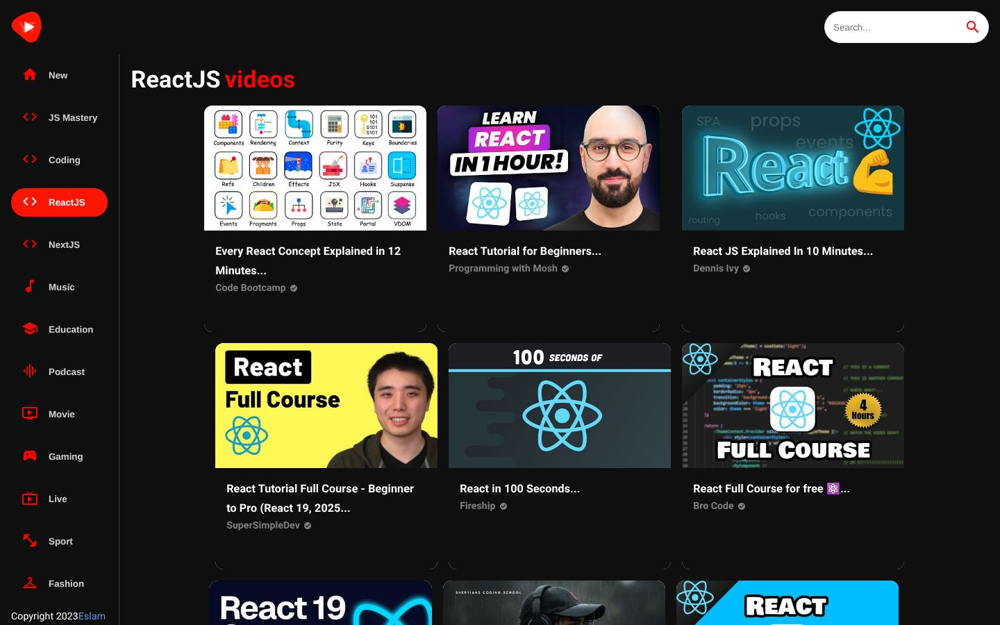
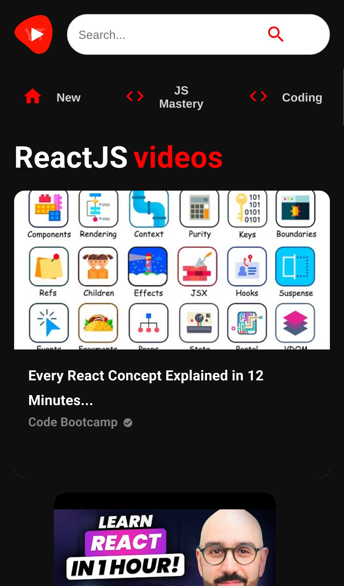

<div align="center">

# uTube: YouTube UI Clone

### A YouTube-style video app built with React and Material UI

Browse videos by category, search, watch videos in an embedded player and open channel pages. Video data comes from the YouTube v3 API on RapidAPI.

[](https://react.dev)
[](https://mui.com)
[](https://reactrouter.com)
[](https://axios-http.com)
[](https://rapidapi.com)
[](https://6545752f7c28b70a8b3bbfcf--fastidious-gaufre-aaeb20.netlify.app/)

**[Live demo](https://6545752f7c28b70a8b3bbfcf--fastidious-gaufre-aaeb20.netlify.app/)** ·
**[Portfolio](https://new-portfolio-ashy-xi.vercel.app/)** ·
**[LinkedIn](https://www.linkedin.com/in/eslamraafat-dev/)** ·
**[Email](mailto:eslamraafat736@gmail.com)**

<br>



</div>

<table>
  <tr>
    <td width="33%"></td>
    <td width="67%" valign="top">
      <b>What the screenshots show</b><br><br>
      The <b>ReactJS</b> category selected in the sidebar. On mobile the sidebar turns into a horizontal, scrollable category bar above the feed.
    </td>
  </tr>
  <tr>
    <td align="center"><sub>Mobile (iPhone 13)</sub></td>
    <td></td>
  </tr>
</table>

---

## Overview

A **UI clone built for practice. It is not affiliated with or endorsed by YouTube or Google.** I made it in 2023 to practise React with a component library (Material UI), client-side routing with URL parameters, and fetching paginated data from a third-party API.

## Features

- **Category feed:** a sidebar of categories (New, Coding, ReactJS, NextJS, Music, Education, Gaming and more); choosing one loads matching videos.
- **Search:** the search bar opens `/search/:searchTerm` with the results.
- **Video page** (`/video/:id`): an embedded player (react-player), the title, channel, view and like counts, and related videos.
- **Channel page** (`/channel/:id`): a gradient header, the channel avatar, subscriber count and the channel's latest videos.
- **Video and channel cards** with thumbnails, trimmed titles and a verified badge.
- **Responsive layout:** sidebar on desktop, horizontal category bar on mobile.
- **SPA routing on Netlify** through a `_redirects` rule, so deep links load correctly.

## Tech stack

| Area | Tools |
| --- | --- |
| UI | React 18.2 (Create React App) |
| Components | Material UI (`@mui/material`, `@mui/icons-material`), Emotion |
| Routing | React Router (`/`, `/video/:id`, `/channel/:id`, `/search/:searchTerm`) |
| Data | Axios, YouTube v3 API on RapidAPI |
| Player | react-player |
| Hosting | Netlify |

## Project structure

This repository holds the **production build** that is deployed to Netlify. The React source isn't committed here, but the source maps in `static/js/*.map` include it.

```
You-tube/
├── index.html          # CRA entry page
├── _redirects          # Netlify SPA fallback: /* -> /index.html
├── static/js · static/css
├── manifest.json · robots.txt · logos
└── docs/screenshots/
```

## Getting started

```bash
git clone https://github.com/Eslamraafat1/You-tube.git
cd You-tube
npx serve -s .     # -s sends deep links to index.html
```

You need an internet connection, because all video data comes from the RapidAPI endpoint.

## Deployment

Deployed on **Netlify**. The demo link above is a Netlify deploy URL.

---

## Author

**Eslam Raafat**, Front-End Developer (React · Next.js · TypeScript)

**[Portfolio](https://new-portfolio-ashy-xi.vercel.app/)** ·
**[LinkedIn](https://www.linkedin.com/in/eslamraafat-dev/)** ·
**[GitHub](https://github.com/Eslamraafat1)** ·
**[Email](mailto:eslamraafat736@gmail.com)**
